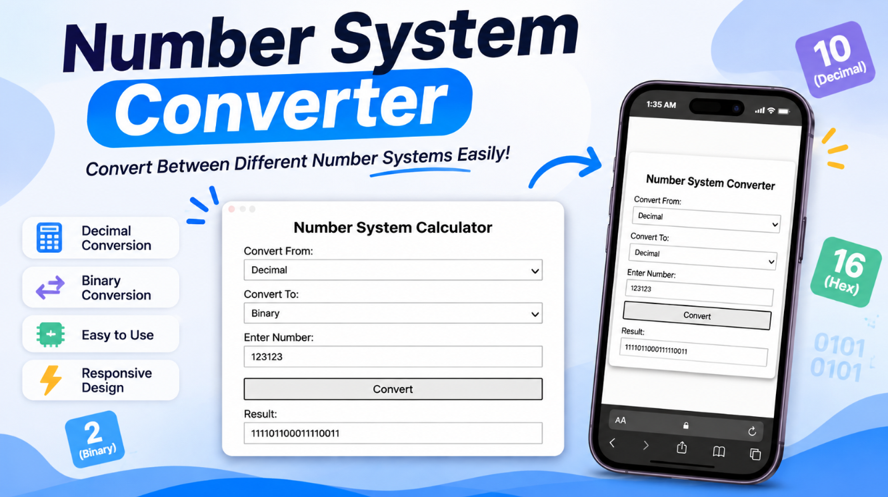

<div align="center">

# Number System Calculator

[](https://github.com/Chesster06/binary-converter)
[](https://developer.mozilla.org/en-US/docs/Web/JavaScript)
[](LICENSE)

**Number System Calculator** is a fast, lightweight, and responsive web tool designed to convert numbers seamlessly across four primary numbering systems: Decimal (Base 10), Binary (Base 2), Octal (Base 8), and Hexadecimal (Base 16).



</div>

---

## Key Features

- **Multi-Base Conversions**: Supports flexible conversion between Decimal, Binary, Octal, and Hexadecimal.
- **Input Validation**: Detects invalid inputs per chosen numeral base and prevents inaccurate outputs.
- **Instant Result Display**: Clear read-only output field for quick copy and calculation verification.
- **Zero Dependencies**: Pure HTML5, CSS3, and Vanilla JavaScript with no frameworks or third-party libraries needed.
- **Clean Responsive UI**: Centered card layout with intuitive select dropdowns and clear action triggers.

---

## Supported Number Systems

| Base | Name | Allowed Digits / Characters |
| :--- | :--- | :--- |
| **Base 2** | Binary | `0, 1` |
| **Base 8** | Octal | `0 - 7` |
| **Base 10** | Decimal | `0 - 9` |
| **Base 16** | Hexadecimal | `0 - 9, A - F` |

---

## Technology Stack

| Layer | Technologies |
| :--- | :--- |
| **Markup** | HTML5 |
| **Styling** | Modern CSS3 (Flexbox & Box-Shadow styling) |
| **Logic** | Vanilla JavaScript (ES6+) |
| **Deployment** | GitHub Pages / Any static hosting |

---

## Getting Started

### Prerequisites

- Any modern web browser (Google Chrome, Firefox, Microsoft Edge, Safari).
- Git (optional, for cloning).

---

### Installation & Execution

#### 1. Clone the Repository

```bash
git clone https://github.com/Chesster06/binary-converter.git
cd binary-converter
```

#### 2. Run the Application

Since this is a client-side static web application, no server or build step is required:

- Simply double-click **`index.html`** to open it directly in your default browser.
- Alternatively, launch via VS Code's **Live Server** extension or Python's built-in HTTP server:

```bash
# Python 3
python -m http.server 8000
```

Then visit `http://localhost:8000` in your browser.

---

## Project Structure

```text
binary-converter/
├── assets/
│   └── Banner.png          # Repository showcase banner
├── index.html              # Main HTML markup and UI structure
├── script.js               # Base conversion and parsing logic
├── style.css               # Application layout and visual styles
└── README.md               # Project documentation
```

---

## Author

- **Developer**: [Chesster (Chesster06)](https://github.com/Chesster06)
